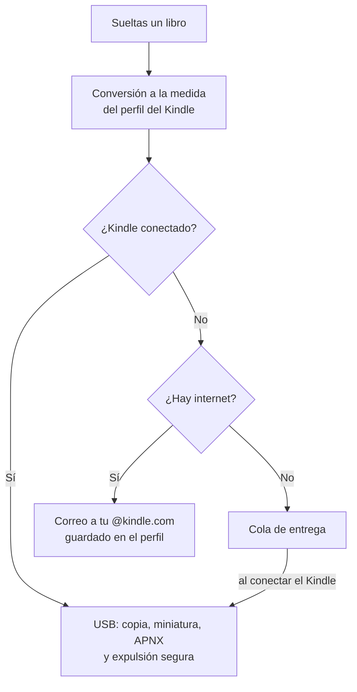

<div align="center">

# Knddle

**Convierte cualquier libro en un ebook que en tu Kindle se ve como uno comprado, y llega solo a tu dispositivo.**

Rust · Tauri · Linux, Windows y macOS · Monocromático · Liquid Glass · Cada detalle importa


</div>

---

## Tabla de contenidos

1. [¿Qué es Knddle?](#qué-es-knddle)
2. [Características de la 1.0](#características-de-la-10)
3. [Como un libro comprado](#como-un-libro-comprado)
4. [Formatos de Kindle y el camino hacia KFX](#formatos-de-kindle-y-el-camino-hacia-kfx)
5. [Compatibilidad con Kindle](#compatibilidad-con-kindle)
6. [Kindle conectado: todo automático](#kindle-conectado-todo-automático)
7. [Pipeline de conversión](#pipeline-de-conversión)
8. [Arquitectura](#arquitectura)
9. [Estructura del repositorio](#estructura-del-repositorio)
10. [Tecnologías](#tecnologías)
11. [Plataformas](#plataformas)
12. [Instalación para desarrollo](#instalación-para-desarrollo)
13. [Diseño e interfaz](#diseño-e-interfaz)
14. [Metas de rendimiento](#metas-de-rendimiento)
15. [Paradigma de desarrollo](#paradigma-de-desarrollo)
16. [Hoja de ruta](#hoja-de-ruta)
17. [Limitaciones](#limitaciones)
18. [Uso responsable](#uso-responsable)
19. [Licencia](#licencia)

---

## ¿Qué es Knddle?

Knddle es una app de escritorio que toma un **archivo** (PDF, EPUB, DOCX y más) o un **link** (incluidos sitios hechos con JavaScript) y lo convierte en un ebook pensado para Kindle: con índice, capítulos, portada, notas al pie emergentes y números de página reales. Luego lo **entrega automáticamente**: por USB si el Kindle está conectado, o por correo si no lo está.

La interfaz tiene solo dos botones, **Insertar** y **Enlace**. Todo lo demás aparece cuando hace falta.

Todo se procesa en tu computador: sin servidores, sin límite de peso y sin subir tus archivos a ningún lado.

---

## Características de la 1.0

### Conversión

| Función | Detalle |
|---|---|
| Muchos formatos de entrada | PDF, EPUB, MOBI/AZW3 sin DRM, DOCX, ODT, RTF, TXT, Markdown, HTML, FB2 y links web |
| Links con JavaScript | Una ventana oculta de la propia app carga la página, ejecuta su JavaScript y extrae el texto limpio |
| Pipeline por fases | Cada archivo pasa por 9 fases hasta el formato final ([ver pipeline](#pipeline-de-conversión)) |
| Limpieza tipográfica profunda | Repara ligaduras rotas ("fi"), guiones invisibles, espacios dobles y saltos de línea en mitad de una frase |
| Índice de dos niveles | Partes y capítulos, como en los libros publicados |
| Idioma detectado automáticamente | La separación silábica y el diccionario del Kindle funcionan sin configurar nada |
| Metadatos y portada automáticos | Título, autor, serie, idioma y portada en alta resolución desde Open Library; si no lo encuentra, genera una portada minimalista en monocromo |

### Experiencia

| Función | Detalle |
|---|---|
| Dos botones | **Insertar** (archivo o arrastrar y soltar) y **Enlace** |
| Vista previa por modelo | Usa la resolución, el tamaño y el aspecto e-ink de tu Kindle: lo que ves es lo que tendrás |
| Edición de capítulos | Renombrar, unir y quitar capítulos, con deshacer (Ctrl+Z) |
| Actualizaciones automáticas | La app se actualiza sola |

### Kindle

| Función | Detalle |
|---|---|
| Detección al conectar | Modelo, número de serie, firmware y resolución en menos de 500 ms |
| Perfil por dispositivo | El correo @kindle.com se escribe una sola vez y se guarda en el llavero del sistema |
| Entrega automática | USB si está conectado, correo si no, y cola de entrega si no hay conexión |
| Aviso de duplicados | Si el libro ya está en el Kindle, ofrece reemplazarlo |
| Varios Kindle | Cada uno con su propio perfil |

---

## Como un libro comprado

Estos son los detalles que hacen que un libro convertido no se distinga de uno de la tienda:

| Detalle | Cómo lo logra Knddle |
|---|---|
| Aparece en **Libros**, no en **Documentos** | Metadato `cdeType=EBOK` |
| Portada visible en la biblioteca | ASIN propio y miniatura copiada a `system/thumbnails` |
| "Página 45 de 320" | Archivo APNX con números de página reales |
| Notas al pie emergentes | Notas marcadas como `epub:type="footnote"`, que el Kindle abre en una ventanita |
| "Ir al inicio" | Apunta al capítulo 1, no a la portada |
| Bookerly y todos los ajustes del Kindle | Sin fuentes incrustadas |
| Inicio de capítulo profesional | Letra capital y versalitas en el primer párrafo |
| Series agrupadas | Metadatos de serie y número de volumen |
| Imágenes nítidas y livianas | Redimensionadas a la resolución exacta del modelo, en escala de grises optimizada para e-ink |

---

## Formatos de Kindle y el camino hacia KFX

Los libros comprados en Amazon vienen en **KFX**, que trae tipografía mejorada, Page Flip y una maquetación más precisa. Amazon no publica cómo se genera, así que Knddle llega a él por fases:

| Fase | Resultado | Fidelidad |
|---|---|---|
| **1** | Generador **AZW3 (KF8) nativo en Rust**, con todos los detalles de la tabla anterior | Alta |
| **2** | **KFX mediante Kindle Previewer**, si lo tienes instalado. Knddle lo detecta y lo usa en segundo plano. No se puede incluir en la app porque su licencia no permite redistribuirlo. | Idéntica |
| **3** | **Generador KFX nativo en Rust**, construido sobre `ion-rs` (la librería oficial de Amazon para el formato Ion) a partir de la estructura documentada por ingeniería inversa. Se valida comparando fragmento por fragmento con la salida de Kindle Previewer. | Idéntica, sin depender de Amazon |
| Siempre | **Send to Kindle por correo**: Knddle envía un EPUB perfecto y Amazon lo convierte a KFX | Idéntica |

---

## Compatibilidad con Kindle

Compatible **desde la 5ª generación en adelante**. Knddle lee el firmware del dispositivo y elige el formato:

| Dispositivo | Formato por USB |
|---|---|
| Modelos con soporte de KFX | **KFX** (cuando la fase 2 o la 3 esté disponible) |
| Cualquier Kindle desde la 5ª generación | **AZW3** |
| Modelos anteriores | **MOBI** |
| Cualquier modelo por correo | **EPUB** (Amazon lo convierte) |

| Conexión | Modelos | Cómo se detecta |
|---|---|---|
| Almacenamiento USB | La mayoría de los modelos anteriores a 2024 | Linux: `udev` · Windows: eventos de dispositivo · macOS: DiskArbitration |
| MTP | Paperwhite 2024, Colorsoft, Scribe 2024 y posteriores | Linux y macOS: `libmtp` · Windows: WPD |

---

## Kindle conectado: todo automático



1. **La primera vez** que conectas tu Kindle, Knddle lo identifica y te pide tu correo @kindle.com. Lo guarda en el llavero del sistema, ligado al número de serie del dispositivo.
2. **Desde entonces**, sueltas un libro y Knddle hace todo lo demás.

---

## Pipeline de conversión

```
1. Ingesta        lee el archivo o el link
2. Análisis       ¿texto, escaneado o maquetación compleja? Elige la estrategia
3. Extracción     texto, imágenes, fuentes y posiciones
4. Estructura     partes, capítulos, títulos, notas al pie, listas, tablas
5. Libro modelo   Book → Chapter → Block (formato interno único)
6. Tipografía     limpieza, comillas, rayas, letra capital, versalitas
7. Validación     revisa errores antes de empaquetar
8. Empaquetado    KFX / AZW3 / MOBI / EPUB según el perfil del dispositivo
9. Entrega        USB, correo o cola
```

Cada fase es un módulo independiente que implementa el trait `Phase`, y cada una se prueba por separado.

---

## Arquitectura

Knddle usa **arquitectura hexagonal** (puertos y adaptadores). El dominio no conoce archivos, red ni dispositivos.

```
        ┌──────────── UI (HTML · CSS · JS) ────────────┐
        └──────────── comandos y eventos Tauri ────────┘
                              │
              ┌───────────────▼───────────────┐
              │          knddle-core          │
              │  Book · Pipeline · Phase      │
              └──┬──────────┬──────────┬──────┘
          puertos│ Source   │ Packager │ Delivery · DeviceWatcher
              ┌──▼───┐  ┌───▼───┐  ┌───▼──────────────┐
  adaptadores │ PDF  │  │ AZW3  │  │ USB / MTP        │
              │ EPUB │  │ EPUB  │  │ Correo           │
              │ Web  │  │ KFX   │  │ Cola             │
              └──────┘  └───────┘  └──────────────────┘
```

---

## Estructura del repositorio

```
knddle/
├── crates/
│   ├── knddle-core/        # Dominio: modelo del libro, pipeline y fases
│   └── knddle-kindle/      # Perfiles de modelos Kindle
├── app/
│   ├── src-tauri/          # Shell Tauri: comandos y composición de dependencias
│   └── ui/                 # Interfaz
│       ├── index.html
│       ├── styles/         # tokens.css · base.css · motion.css
│       └── components/     # Un módulo JS por componente
├── .github/workflows/      # CI: Linux, Windows y macOS
├── CLAUDE.md
└── README.md
```

---

## Tecnologías

| Área | Herramienta |
|---|---|
| App de escritorio | **Tauri 2** |
| Núcleo | **Rust** |
| Concurrencia | `tokio` + `rayon` |
| PDF | `pdfium-render` |
| Web con JavaScript | Webview de Tauri en ventana oculta + `readability` |
| EPUB | `epub-builder` |
| AZW3 / KF8 | Generador propio en Rust |
| KFX | Kindle Previewer (fase 2) y `ion-rs` (fase 3) |
| Imágenes | `image` + `fast_image_resize` |
| Idioma | `whatlang` |
| Correo | `lettre` |
| Credenciales | `keyring` |
| Interfaz | HTML + CSS + JavaScript vanilla, con animaciones de **Motion** |
| Tipografías | **Inter** (interfaz) y **Literata** (vista previa) |
| Calidad | `cargo test`, `clippy`, `rustfmt`, Playwright para la interfaz |

---

## Plataformas

| Sistema | Paquete | Motor de la interfaz |
|---|---|---|
| Debian / Ubuntu | `.deb` · AppImage | WebKitGTK |
| Fedora | `.rpm` · Flatpak | WebKitGTK |
| Arch | AUR · AppImage | WebKitGTK |
| Windows 10/11 | `.msi` | WebView2 |
| macOS (Intel y Apple Silicon) | `.dmg` | WKWebView |

---

## Instalación para desarrollo

### Dependencias del sistema

```bash
# Fedora
sudo dnf install webkit2gtk4.1-devel openssl-devel libappindicator-gtk3-devel librsvg2-devel libmtp-devel
sudo dnf group install "c-development"

# Debian / Ubuntu
sudo apt install libwebkit2gtk-4.1-dev build-essential libssl-dev libayatana-appindicator3-dev librsvg2-dev libmtp-dev

# Arch
sudo pacman -S webkit2gtk-4.1 base-devel openssl libappindicator-gtk3 librsvg libmtp
```

En Windows y macOS solo hacen falta [Rust](https://rustup.rs) y [Node.js](https://nodejs.org).

### Ejecutar

```bash
git clone https://github.com/<usuario>/knddle.git
cd knddle

cargo test --workspace          # tests del núcleo

cd app
npm install
npm run tauri dev               # app en modo desarrollo
npm run dev                     # solo la interfaz en el navegador: http://localhost:1420
npm run tauri build             # instaladores para el sistema actual
```

---

## Diseño e interfaz

Inspirado en las apps de Apple: claridad, deferencia y profundidad.

### Paleta monocromática

Negro primero. Grises y blanco, sin color de acento: la jerarquía sale de la luz, la profundidad y el peso tipográfico. Los valores viven en `app/ui/styles/tokens.css`.

### La escena

Fondo negro con una luz blanca suave que cae desde arriba a la derecha y un brillo tenue abajo a la izquierda. Todo está cubierto de **grano fino**, como arena blanca y negra. El grano se pinta una vez en un canvas, a un píxel físico por grano para que se vea nítido, con grises en curva de campana alrededor del gris medio. La escena casi no se mueve: una sola deriva muy lenta de la luz, y nada que siga al mouse.

### Liquid Glass: el mouse es la luz

El vidrio no se mueve, no se inclina ni rebota. **El mouse es una fuente de luz y el vidrio solo la refleja:**

| Capa | Efecto |
|---|---|
| Desenfoque | Suaviza la escena y su grano: el vidrio se ve pulido sobre un fondo de arena |
| Brillo | Una banda tenue más intensa arriba, como un vidrio grueso |
| Grosor | Luz atrapada a lo largo de los bordes |
| Borde | Una línea de 1 px que brilla del lado donde está la luz, y con más fuerza cuanto más cerca está |
| Reflejo | Un reflejo suave que se desliza hacia la luz |

La luz se mueve con resortes con amortiguación crítica: llega suave y nunca se pasa de largo. Si la luz se aleja, el reflejo se apaga poco a poco.

### Forma

Esquinas con curvatura continua, como en Apple, no el redondeo estándar. Sombras suaves en capas. El desenfoque del fondo (`backdrop-filter`) se usa solo en los paneles; los botones reutilizan el del panel en el que están.

### Movimiento

| Regla | Detalle |
|---|---|
| Física real | Solo resortes, nunca curvas lineales |
| Rendimiento | Solo se animan `transform` y `opacity` |
| Interrumpibles | Cualquier animación se puede invertir a mitad de camino |
| Accesibles | Si el sistema pide reducir movimiento, se usan fundidos breves |

### Momentos clave

| Momento | Animación |
|---|---|
| Kindle conectado | El dispositivo aparece desde abajo con un resorte suave y luego su modelo y espacio libre |
| Kindle desconectado | Se encoge, se desenfoca y desaparece; el resto se reacomoda sin saltos |
| Envío por correo | El libro se dobla en un avión de papel que vuela en curva y se convierte en ✓ |
| Procesamiento | Sin spinners: anillo con el porcentaje real y la fase actual en un fundido |
| Arrastrar y soltar | La zona de destino "respira" y absorbe el archivo |

### Estados

Cada pantalla tiene diseñados sus estados de **vacío, carga, error y éxito**. Nunca aparece un código de error sin explicación.

---

## Metas de rendimiento

| Métrica | Meta |
|---|---|
| Arranque en frío | < 400 ms |
| Animaciones | 60 fps estables (120 donde la pantalla lo soporte) |
| PDF de 300 páginas → AZW3 | < 3 s |
| Instalador | < 15 MB |
| Detección del Kindle | < 500 ms |

---

## Paradigma de desarrollo

### SOLID

| Principio | Aplicación |
|---|---|
| **S**: responsabilidad única | Cada fase del pipeline hace una sola cosa |
| **O**: abierto/cerrado | Un formato o una fuente nueva es un adaptador nuevo |
| **L**: sustitución de Liskov | Cualquier `Packager` o `Delivery` puede reemplazar a otro |
| **I**: segregación de interfaces | Traits pequeños: `Phase`, `Source`, `Packager`, `Delivery`, `DeviceWatcher` |
| **D**: inversión de dependencias | El núcleo depende de traits; las implementaciones se inyectan en `src-tauri` |

### Clean Code

- Código en inglés; interfaz en español.
- Funciones cortas y nombres que se explican solos.
- Sin números mágicos.
- Errores tipados con `thiserror`.

### Extreme Programming

- Historias de usuario.
- TDD: primero el test.
- Iteraciones cortas.
- Diseño simple y refactorización continua.
- CI en los tres sistemas en cada push.

### Definición de terminado

Una función está terminada solo cuando:

- tiene tests;
- tiene diseñados sus estados de carga, error y vacío;
- su animación va a 60 fps en WebKitGTK;
- funciona en Linux, Windows y macOS;
- pasa `fmt`, `clippy` y `test`.

### Commits

Se usa [Conventional Commits](https://www.conventionalcommits.org/): `feat(core): …`, `fix(kindle): …`, `test(pipeline): …`.

---

## Hoja de ruta

- [x] **Iteración 0: base**
  - [x] Workspace de Rust y app Tauri
  - [x] Modelo `Book` y pipeline por fases
  - [x] Limpieza tipográfica
  - [x] Perfiles de modelos Kindle
  - [x] Tokens de diseño y liquid glass
- [ ] **Iteración 1: PDF → AZW3**
  - [ ] Extracción con pdfium
  - [ ] Estructura e índice de dos niveles
  - [ ] Generador AZW3 nativo (EBOK, ASIN, APNX, miniatura)
- [ ] **Iteración 2: interfaz**
  - [ ] Insertar / Enlace con arrastrar y soltar
  - [ ] Vista previa por modelo
  - [ ] Edición de capítulos con deshacer
- [ ] **Iteración 3: Kindle**
  - [ ] Detección USB y MTP en los tres sistemas
  - [ ] Perfiles de dispositivo y aviso de duplicados
- [ ] **Iteración 4: entrega automática**
  - [ ] Correo, cola y expulsión segura
- [ ] **Iteración 5: más formatos**
  - [ ] EPUB, DOCX, links web
  - [ ] Metadatos, portadas e idioma automáticos
- [ ] **Iteración 6: distribución**
  - [ ] Instaladores para los 5 sistemas
  - [ ] Actualizaciones automáticas
- [ ] **Después de la 1.0**
  - [ ] KFX nativo
  - [ ] Gestión de la biblioteca del Kindle
  - [ ] Cómics
  - [ ] Inglés
  - [ ] Colecciones

---

## Limitaciones

- **X-Ray** y las funciones que dependen de los servidores de Amazon no se pueden reproducir.
- **KFX** depende de Kindle Previewer hasta que esté el generador nativo (fase 3).
- Los **PDFs con maquetación compleja** (fórmulas, varias columnas) pueden requerir el modo recorte.
- El **correo** está limitado a 25 MB por el adjunto de Gmail; por USB no hay límite.

---

## Uso responsable

Knddle es para uso personal con documentos propios o con libros que una página ofrece gratis de forma legítima. No elimina DRM, no evade muros de pago ni inicios de sesión, y no debe usarse para redistribuir contenido protegido.

---

## Licencia

MIT. Ver `LICENSE`.

<div align="center">

Hecho por **Sebastian Romaña** · Romagna Group

</div>
